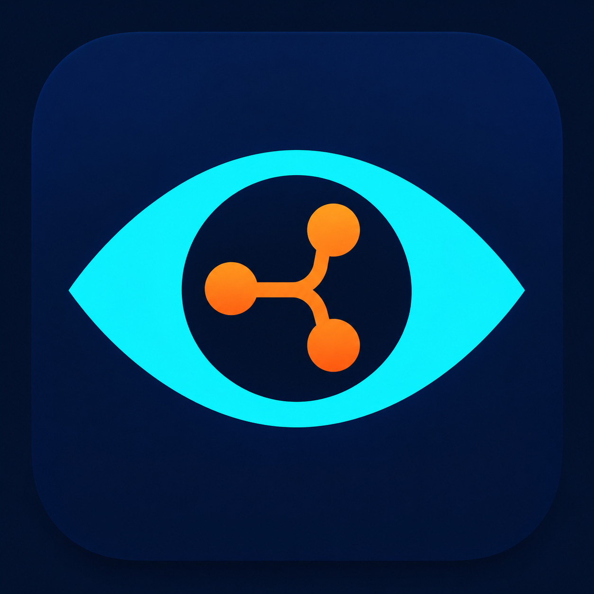

# KommitEye



Review Git commits with a local or cloud OpenAI-compatible model. The repository
contains two applications sharing the same review engine:

| Application | Interface | Windows x64 distribution |
| --- | --- | --- |
| Desktop 3.6.3 | WPF desktop app with a system tray icon | Self-contained EXE |
| Service 3.6.3 | ASP.NET Core server with a bundled React browser UI | Windows service MSI or portable ZIP |

Both support multiple repositories, review reports and mail notifications.
Both editions share `Version` in `Directory.Build.props`. The server and React UI are
packaged together. Shared libraries and the server now target portable .NET 10;
Windows keeps its existing DPAPI credential format. Linux server execution requires
an explicitly configured key certificate. Published installers remain Windows-only;
A Linux Docker image with Compose is available; the Avalonia desktop remains follow-up work. See
[platform architecture](docs/platform-architecture.md).

### Docker Server

Build and run the server with its web interface using
[Docker Compose](deploy/docker/README.md). Configuration, data and protection keys
remain outside the image. The container runs as a non-root user; initial setup
creates its administrator password and persistent protection certificate.

## Requirements and setup

- Windows 10/11 and Git in `PATH`.
- A model endpoint supporting tool calls (for example vLLM, Ollama, LM Studio,
  or a compatible cloud API).
- Published packages include the .NET 10 runtime.
- Building from source requires the .NET 10 SDK. Building the web UI also requires
  Node.js 24 and pnpm 11.25.0, matching GitHub Actions.

### Service

Run `KommitEye-Service-<version>-win-x64.msi` as an administrator. Select the
application/data folders, port, network access and the Git executable. New services
use `NT SERVICE\KommitEye` without a user password. The persistent configuration is
`%ProgramData%\KommitEye\Server\server.json`, with data in its `data` subdirectory. Setup requires .NET Framework
4.7.2 or newer for installer actions, in addition to the bundled server runtime.

Alternatively, extract the portable ZIP and run `KommitEye.Server.exe` directly
(or `Start-KommitEye.ps1`); service installation is optional. On first startup the
executable creates the same default `server.json` in both modes, with an explicit
data path, `http://127.0.0.1:5080`, `git.exe` for PATH discovery, and `CurrentUser`
credential protection. Existing files are preserved. Use
`--config "D:\KommitEye\server.json"` for another location, including a missing file.
Existing files and folder permissions are preserved. See the
[configuration fields, defaults and precedence](docs/server-web.md#configuration-initialization-and-location).
On the server computer, open `http://localhost:5080` (or your selected port) and
create the web administrator password. Legacy service accounts are preserved on upgrade. Repository paths and Git credentials refer
to the server computer, not the browser computer.

The MSI installs the `KommitEye` service. Uninstall through Windows Installed apps
or the MSI's **Remove** option. Application files, the service and installer-created
firewall rules are removed; data and saved installation settings are retained.

See [server configuration and migration](docs/server-web.md) and
[MSI setup, upgrades and removal](docs/windows-installer.md).

### Desktop

Run the published `KommitEye-Desktop-<version>-win-x64.exe`, or start from source:

```powershell
dotnet run --project KommitEye/KommitEye.csproj
```

Select a repository and branch, configure and test a model profile, then click
**Start**. Projects can run concurrently; Start/Stop affect the selected project.
Closing the window keeps the app in the system tray. Use **Exit** to quit.

## Build packages

Run from the repository root:

```powershell
./build/publish.ps1 -Product Desktop
./build/publish.ps1 -Product Service
./build/publish.ps1                     # both products
```

Outputs in `artifacts/`:

- `KommitEye-Desktop-3.6.3-win-x64.exe`
- `KommitEye-Service-3.6.3-win-x64.zip`
- `KommitEye-Service-3.6.3-win-x64.msi`
- `SHA256SUMS-<product>.txt`

WiX is restored through NuGet; a global WiX installation is not needed. MSI builds
run package and read-only preflight checks, without installing the service.
To verify a Service ZIP locally, run `./build/verify-service-package.ps1 -Path <zip>`.
This starts the packaged EXE with isolated fixture data and checks its API and
bundled React assets. Both packaging workflows run this check before uploading.
Local installers are unsigned. The desktop-only helper
`./KommitEye/publish-win-x64.ps1` also places its EXE in `KommitEye/dist/`.

### GitHub Actions

- **Build and Release** verifies the code and builds both Desktop and Service
  on pushes to `master`/`codex/**`, pull requests to `master`, and manual runs.
  Download `KommitEye-Desktop` and `KommitEye-Service` from the run's **Artifacts**.
  Successful push/manual runs on `master` publish one `KommitEye <version>` release
  with tag `v<version>`, containing Desktop EXE, Service MSI, Service ZIP and a
  combined SHA-256 list. Publication waits for both packages and all checks.
  Windows, Linux and macOS platform checks are required before packaging and release.
  Bump `Version` and push to `master` for the next complete release.
  Existing releases are left unchanged; use a new version if its tag is already published.
- **Build Service Installer** is a manual server-only build: **Actions → Build Service
  Installer → Run workflow**. Download `KommitEye-Service-Installer` for the MSI,
  portable ZIP and checksums. This workflow does not publish a release.

Workflow artifacts are retained for 14 days. Build outputs are not committed to Git.

## Repository layout

| Path | Contents |
| --- | --- |
| `KommitEye/` | WPF desktop UI, assets and default configuration templates |
| `src/KommitEye.Core/` | Shared models and platform contracts |
| `src/KommitEye.Platform/` | Windows credential protection and platform Git tools |
| `src/KommitEye.Infrastructure/` | Git, model API, mail and persistence |
| `src/KommitEye.Engine/` | Review execution and project coordination |
| `src/KommitEye.Server/` | API, authentication, background work and web hosting |
| `src/KommitEye.Web/` | React/TypeScript browser UI |
| `build/` | Publishing, migration, service scripts and WiX installer sources |
| `checks/` | Automated fixture and integration checks |
| `docs/` | Deployment and installer documentation |
| `.github/workflows/` | CI builds and release automation |

`artifacts/`, `bin/`, `obj/`, `dist/`, `node_modules/`, local data and `authMail/`
are ignored. Keep local secrets out of source files; `.gitignore` does not remove
files already committed to Git. Commit example configuration and the pnpm lockfile,
not real credentials or generated packages.

## Reviewing commits

The window/button instructions below describe Desktop. For the browser interface
and its mail authentication flows, see [Service documentation](docs/server-web.md).

- Automatic monitoring tracks progress separately for each repository and branch.
- **Find commit** searches loaded hashes and descriptions; **Load 100 more**
  extends the list. Review any SHA manually or choose an automatic starting point.
- The model explores committed content using read-only Git tools. Reports contain
  findings with file and line locations; the Journal and Log show review progress.
- With fetch enabled, a checked-out local branch can advance by fast-forward
  after review. This requires a clean working copy. Select a remote-tracking
  branch to leave working files unchanged.
- Local-only repositories, linked worktrees, submodules, and private remotes
  are supported. Configure SSH/HTTPS authentication in **Project**.

Temporary API/network failures use bounded exponential retries (the model's **Max retries**),
respecting `Retry-After`. Retries preserve the current conversation and share the original
review deadline. Authentication, endpoint/model configuration and context-overflow errors
are reported directly; configuration errors stop automatic review. Exhausting the deadline
always produces an incomplete-review report, including when the model is silent.
Optional model metadata times out after 5 seconds and falls back to manual model entry.
**Stop** cancels the operation. HTTP errors retain status, request ID and a bounded,
sanitized response excerpt even if reading the error body times out (3 seconds).

The main window shows the project dashboard. Sidebar buttons open Project, Models,
Mail, System prompt, Journal, and Reports in separate windows. **Apply changes** saves and
keeps the window open; **OK** saves and closes it. **Cancel** or closing the window
discards edits since the last Apply, including checkbox changes. Model and prompt
changes affect subsequent reviews, not an active request.

## Reports and SQLite storage

Desktop and Service store reports in `reports.db` inside their data directory.
All repositories and branches share the same review table; findings are stored
in a separate table. Each repository/branch pair has one current result per
commit SHA.

Open **Reports** in Desktop's sidebar or the Service web UI to browse individual
commit reviews. Search across SHA, author, subject, repository, branch and report
text, including imported Markdown. Search is case-insensitive and supports
Cyrillic. Select a repository/branch to narrow the results, and sort by saved date,
commit date, author, subject, branch, repository or SHA in either direction.
Results are paged in groups of 50; search and sorting apply to all active reports,
not just the current page. Cleared reports are excluded.

Desktop shows the selected review in the same window and can save it as Markdown.
The web UI opens individual reviews as HTML and offers Markdown/HTML downloads.
Both interfaces retain access to the full branch report, including legacy reports
without recognizable commit entries. For imported reviews, the saved date is the
original report file's modification date; unknown commit metadata remains empty.

The **Bug / No bug** column and filter distinguish reviews with findings from
completed reviews without findings. Failed reviews, empty diffs and unknown or
unstructured results have separate states. Imported reports use their recognized
English/Russian result line; an unrecognized result is never treated as clean.
The result filter combines with text search and branch selection before pagination.

- Reviewing a new commit adds its result to the branch report.
- Rechecking the same SHA in the same branch replaces its previous result and
  findings, keeping its original position. Findings from successive checks are
  not merged.
- The same SHA in another branch or repository has a separate result.
- Clearing a report archives its group in SQLite. Subsequent checks start a new
  report; archived data remains in the database.

The Service Reports page provides Markdown and HTML exports generated from
SQLite. Desktop opens a generated Markdown file in `report-exports/`. Exported
files can be shared independently; editing an export does not update the database.

### Upgrading existing reports

Existing `reports/*.md` files are imported automatically when the report store is
first opened. No manual conversion is needed. Original files remain unchanged,
and their complete text is also retained in the database.

The importer recognizes commit blocks and older manual-review entries. If a file
contains multiple entries for the same SHA, the last result is retained at the
first entry's position. The complete original text, including duplicates, remains
available in `legacy_imports`. Unrecognized reports are preserved as text.

Legacy findings remain in the imported Markdown; they are not reconstructed as
structured finding rows. New checks populate structured fields and findings.
Import is transactional per file and recorded by filename, so restarting neither
duplicates imported reports nor restores cleared ones. Later edits to imported
Markdown files are not synchronized back to SQLite.

### Backup and transfer

Stop the application or service before backing up its data directory. Include
`reports.db` and `reports.db-wal` if present: the WAL may contain the latest saved
reviews. Keep the original `reports/` directory as well.

To transfer Desktop data to a new, empty directory:

```powershell
./build/Import-DesktopData.ps1 -Source "<desktop-data-directory>" -Destination "<new-data-directory>"
```

The script preserves the source and copies the database together with its WAL;
it requires exclusive access to those files. Older file-only application versions
cannot read new SQLite reports. Export reports before downgrading if needed.
See [report storage and migration](docs/server-web.md#html-report-export) for details.

## Gmail notifications

1. Enable Gmail API in Google Cloud and configure the OAuth consent screen.
   In Testing mode, add your account to the test users.
2. Create a **Desktop app** OAuth client and download its JSON.
3. In **Mail**, select the JSON and click Connect, then **Apply changes**
   to authorize Google through your browser.
4. Set recipients (separated by `;`), enable notifications, and apply changes.
   **Send test email** checks delivery using a message without repository data.

The app requests `gmail.send`, `openid`, and `email`; it does not read your inbox.
Tokens refresh automatically and are stored with Windows DPAPI for the current
Windows user. Authorization errors pause delivery until reconnection. Disconnect
removes local authorization and attempts to revoke Google access.

Reports can be attached as HTML or Markdown. Sending clean reviews or sending to
commit authors is optional; enable author delivery only for trusted repositories.
Terminal review failures are sent to the configured **Recipients**, without adding
the commit author, even when clean-review notifications are disabled. Notifications
must be enabled. Canceled reviews and temporary model outages do not send failure mail.
Pending messages survive restarts and stay tied to their original account.
Provider acceptance does not guarantee inbox delivery, and retries after an
ambiguous network failure can produce duplicates.

Google Testing refresh tokens generally expire after seven days; see
[Google OAuth token expiration](https://developers.google.com/identity/protocols/oauth2#expiration).
Keep OAuth JSON files and token caches out of Git; `authMail/` and
`client_secret_*.json` are ignored.

## Outlook / Microsoft 365

The Mail section has separate Google, Outlook, and SMTP tabs; connections and
settings are retained. Switching tabs does not change the sender. Use
**Use this account**, then **Apply changes**, to select the sender for new reports.
Connecting and disconnecting accounts also take effect only after Apply or OK.

For SMTP, open **Mail → SMTP → SMTP server settings…**. The separate dialog contains
the host, port, security mode, username, password, and sender address. Port 587 with
StartTLS is the default; SSL-on-connect and unencrypted connections are also available.
A blank password keeps the saved password; use **Clear saved password** to remove it.
Passwords are protected with Windows DPAPI. Confirm the dialog, set recipients and
notification preferences in Mail, and click **Apply changes** or **OK** to save.
Use **Send test email** to test the current settings without saving them.

Register a Microsoft Entra application for your organization or for personal and work/school accounts.
Add the **Mobile and desktop applications** platform with `http://localhost`
as its redirect URI and Microsoft Graph delegated permissions `User.Read` and
`Mail.Send`. Enter **Application (client) ID** and **Directory (tenant) ID** from Overview in the Outlook tab (use `common` for personal/multitenant apps), then connect
through your browser. No client secret is required; organization policies may
require administrator consent.

Tokens refresh automatically and the MSAL cache is protected with Windows DPAPI.
Disconnect removes local tokens; it does not revoke Microsoft consent or sign out
the browser. Queued messages stay tied to their original provider and account.

## Data and compatibility

Desktop settings, review positions, reports, queues, and logs live in
`%LOCALAPPDATA%\KommitEye`. Set `KOMMITEYE_DATA_DIR` for an isolated data directory.
Service uses `%PROGRAMDATA%\KommitEye.Server` by default when installed by MSI,
the extracted package's `data/` folder with the portable startup script, or
`%LOCALAPPDATA%\KommitEye.Server` when launched directly. Do not share a data
directory between Desktop and Server.
Model profiles may contain API keys; detailed logs can contain repository content.
Inspect logs and crash reports before sharing them.

See [Reports and SQLite storage](#reports-and-sqlite-storage) for report migration,
exports, and backup instructions.

Previously called **Git Reviewer**. Existing installations keep using
`%LOCALAPPDATA%\GitReviewer` if the new directory does not exist.
`GITREVIEWER_DATA_DIR` and `GITREVIEWER_SNAPSHOT_MB` remain supported; the new
`KOMMITEYE_*` names take precedence. Existing data is not deleted by the rename.

## Checks

Run from the repository root on Windows; these use fixtures instead of real
model or email accounts:

```powershell
dotnet build KommitEye/KommitEye.csproj
dotnet run --project checks/Gmail/Gmail.csproj
dotnet run --project checks/Outlook/Outlook.csproj
dotnet run --project checks/ApplyChanges/ApplyChanges.csproj
dotnet run --project checks/CommitPaging/CommitPaging.csproj
dotnet run --project checks/Reports/Reports.csproj
dotnet run --project checks/ReportRepair/ReportRepair.csproj
dotnet run --project checks/ModelAvailability/ModelAvailability.csproj
dotnet run --project checks/Server/Server.csproj
dotnet run --project checks/Installer/Installer.csproj
```
